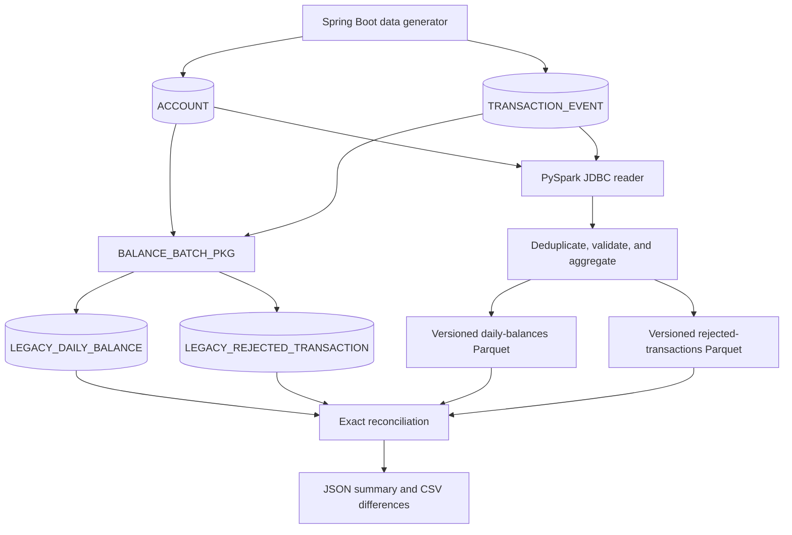

# Architecture

## System flow

## Components

| Component | Responsibility |
| --- | --- |
| Dev Container `app` | Runs Java 17, Maven, Python 3.12, uv, and PySpark 4.2 |
| Compose `oracle` | Hosts Oracle Database Free and its persistent data volume |
| `legacy-app` | Creates the schema, generates source rows, and invokes PL/SQL |
| `account_migration` | Reads Oracle, transforms events, writes Parquet, and reconciles |
| `scripts/` | Provides repeatable individual commands and the interactive demo |

## Data ownership and changes

| Stage | Oracle source tables | Oracle legacy outputs | Local files |
| --- | --- | --- | --- |
| Generate data | Replaced when cleanup is enabled | Cleared by cleanup | Unchanged |
| Run legacy batch | Read only | Replaced for the selected run | Unchanged |
| Run PySpark | Read only | Read only | Versioned Parquet is written |
| Reconcile | Read only | Read only | Latest JSON and CSV reports are replaced |

Oracle data persists in the Compose `oracle-data` volume. PySpark output is
versioned by processing date and batch ID, while reconciliation reports always
describe the most recently compared run.

## Boundaries

The application is intentionally a local batch demonstration. It has no REST
API, frontend, authentication layer, cloud deployment, orchestration platform,
or medallion architecture.
